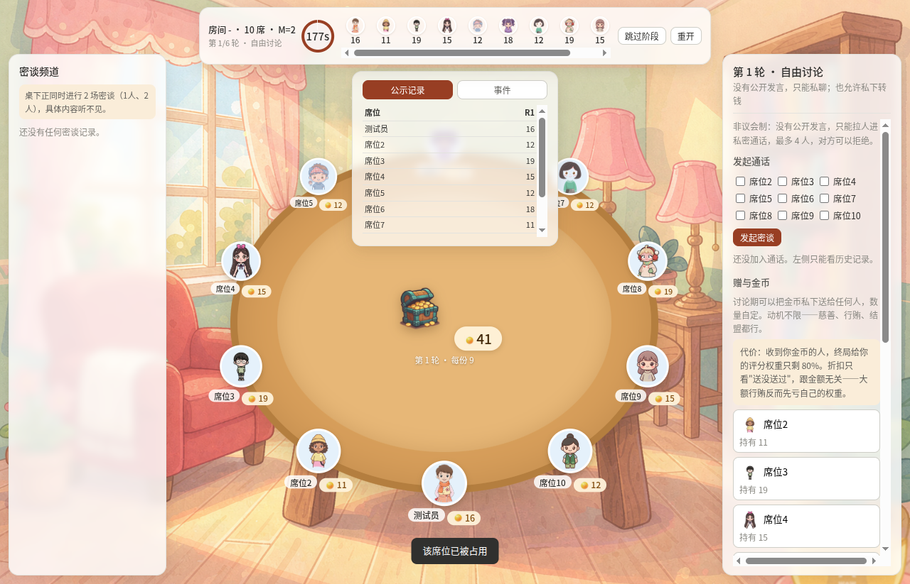
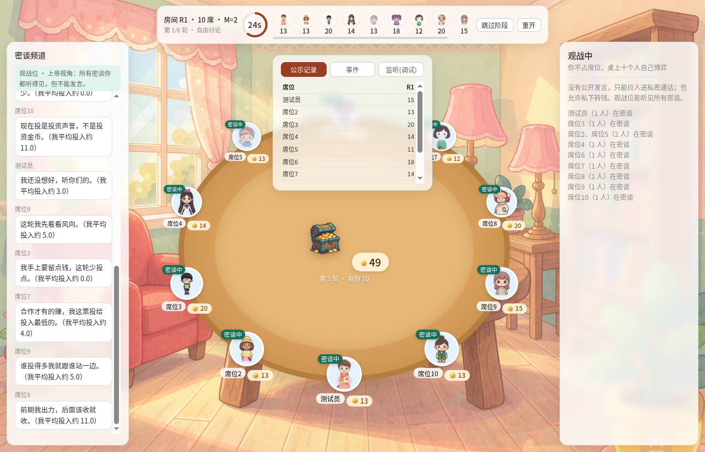

# 公共财博弈 · 推理博弈

十个人围坐一张桌子，每轮把金币投进桌心那只箱子。箱内总额翻倍后**全员平分**——不投的人照样分红。

于是每个人面前都摆着同一道选择题：**投钱，全桌变富，自己净亏；不投，白拿别人的钱。** 合作只能靠投票、赠与和桌下的密谈逼出来。



## 运行

游戏跑在你自己的机器上，用独立窗口游玩。

| 方式 | 怎么做 |
|---|---|
| **Windows 安装版** | 双击 `公共财博弈-安装版.exe`，一路下一步；桌面和开始菜单会出现快捷方式 |
| **Windows 绿色版** | 解压 `公共财博弈-绿色版.zip`，双击 `启动游戏.exe` |
| **桌面窗口** | `npm install` 然后 `npm run app` |
| **命令行** | `npm install` 然后 `npm start`，浏览器开 <http://127.0.0.1:8787> |

Windows 的两个版本**自带运行时**：不需要装 Node.js，不需要 `npm install`，安装过程也不联网。源码方式才需要 [Node.js](https://nodejs.org) 18+。

多人联机时，各人的客户端通过一个公共中继牵线，地址已内置（也可用环境变量 `PGG_RELAY` 指定，填 `off` 则完全离线）。

## 一局流程

每轮依次经过：

| 阶段 | 做什么 |
|---|---|
| 投资 | 选投入公共箱 0 ~ 当前持有 枚，**不公示** |
| 投票（第 2 轮起） | ≥6 票可指定 1 人本轮不参与分红，他投进去的钱全部沉没 |
| 结算 | 箱内总额 × M ÷ 分红人数，向上取整 |
| 公示 | 只公布每个人的持有数，**不公布投入**，只能反推 |
| 自由讨论 | 非议会制：没有公开发言，只能拉人进私密通话（≤4 人，对方可拒）；期间可私下赠与任意数量金币 |

6 轮结束后互评 1~5 分，按「打分人的金币占比」加权，前 5 名获胜。


## 建房数值

- **席位** 2 ~ 12（默认 10）
- **轮次** 1 ~ 12（默认 6）
- **倍数 M**（默认 2）：每份 = ceil(箱内总额 × M ÷ 分红人数)
- **每轮投入上限**（默认 0 = 不限制）

M 是困境的来源：席位 N 人时，自己多投 1 枚只分回 M/N 枚，净亏；但全员各投 x 时每人分回 M·x/N，**M 越大合作越划算**。M 超过席位数后困境消失，想保留张力就把 M 压在席位数以下。

## 赠与（自由讨论期）

- 可以把金币私下送给任何人，数量自定，动机不限。
- 赠与不改变场内金币总量，只做财富转移。
- 公示有三档：全公开 / 只公示笔数与总额（默认）/ 完全不公示。
- 收到你金币的人，终局给你的评分权重打 0.8 折（可关）；折扣只看送没送过，与金额无关。

## 联机


打开先进房间大厅：建房后勾上「开放到网络」，别人的客户端用房号就能加入；也可以从列表里挑一个带「网络」标记的房间进去。设了密码的房间需要口令。


房主在建房页能拿到自己的 4 位房号，复制发给朋友即可。房间由房主这台机器托管，房主关掉客户端房间就散了。

**观战位**不占席位，可以只看不玩，能听见所有密谈：



## AI 席位

每个席位三种形态，在建房界面里逐席位配置：

- **真人** —— 需要一个客户端占一个席位
- **本地策略** —— 内置 5 种人格，离线可用，会把整局跑满
- **云端 API** —— 填 OpenAI 兼容格式的 baseUrl / Key / 模型

也可以一键把十席全部交给 AI，自己退到观战位看戏。人格在网络包里不下发。

## 目录结构

```
server/       engine.js 规则引擎 · ai.js AI 策略 · index.js 本地服务
              gateway.js 本地网关 · relay.js 联机中继
public/       index.html / app.js / style.css / assets
electron/     main.cjs 桌面窗口外壳
launcher/     launcher.c Windows 启动器源码
relay/        中继的部署目录
tools/        build-win.sh 打 Windows 安装包 · shot.js 截图验证
发布/         打包产物（不进 git，走 Release 分发）
启动游戏.exe   Windows 双击启动（源码方式用）
启动游戏.sh   Linux / macOS 双击启动
```

Windows 打包产物超过 GitHub 单文件 100MB 限制，不要 `git push`，放到 Release 的附件里。

## 开发

```bash
npm install
npm start        # 起本地网关
npm run app      # Electron 桌面窗口
npm run smoke    # 端到端：真起服务跑完 6 轮
```

测试：

```bash
node test/engine.test.js      # 规则引擎
node test/ui.test.js          # 前端渲染（jsdom）
node test/smoke.js            # 端到端跑完整局
node test/net.test.js         # 引擎联机：大厅 / 密码房 / 多房间隔离
node test/gateway.test.js     # 客户端架构：中继 + 两台网关
```

截图验证：`node tools/shot.js <lobby|invest|vote|settle|discuss|scoring|over|watch|hall> <输出.png>`

## 说明

通话是文字私密频道，不是语音。素材由 AI 生成，随本仓库使用。
